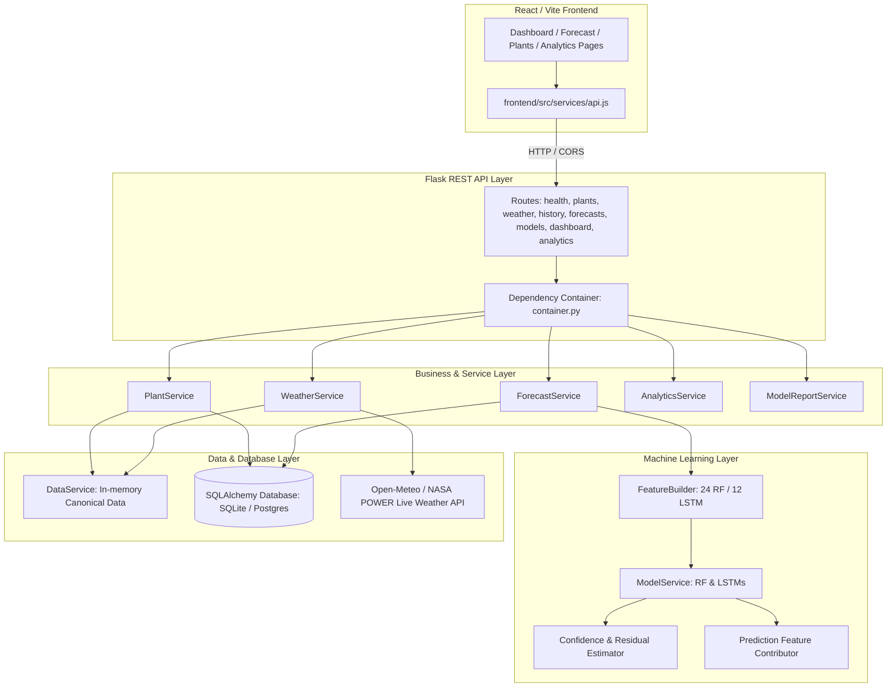

# ENERVISION — Comprehensive Backend Audit & System Specification

**Date:** 2026-10-27  
**Branch:** `member1` (tracking `origin/member1-recovery`)  
**Project:** ENERVISION — Plant-Wise Daily Renewable Energy Generation Forecasting for Karnataka  

---

## 1. Executive Summary

This audit assesses the state of the ENERVISION repository on branch `member1`. It establishes a definitive baseline across the frontend, backend, machine learning models, preprocessing pipelines, datasets, contracts, and database requirements before any architectural additions are made.

The repository contains a highly developed ML pipeline, trained production model artifacts, extensive datasets, an existing Flask REST API (65 passing unit/integration tests), and a full React/Vite/Tailwind frontend dashboard.

---

## 2. Answers to the 14 Core Audit Questions

### 1. What backend already exists?
A structured Flask REST API in `backend/` consisting of:
- **Application Factory & WSGI:** `backend/app.py`, `backend/app_factory.py`, `backend/wsgi.py`.
- **Dependency Container:** `backend/container.py` (singleton dependency injection container ensuring data, models, and contracts are loaded once at startup).
- **Service Layer:**
  - `data_service.py`: Dataset loading, plant identity resolution, indexing, and validation.
  - `model_service.py`: Artifact loading, scikit-learn & Keras inference, and non-negative clamping.
  - `feature_builder.py`: Feature vector construction strictly complying with frozen contracts.
  - `forecast_service.py`: Forecast orchestration (1–7 day horizon), weather availability gating, and history verification.
  - `weather_service.py`: Observed historical weather retrieval and future weather provider interface.
  - `plant_service.py`: Plant catalogue and detailed history.
  - `analytics_service.py`: Aggregated descriptive fleet and plant statistics.
  - `model_report_service.py`: Metric reporting and feature importance handling.
- **Routes Layer:** `health.py`, `plants.py`, `history.py`, `weather.py`, `forecasts.py`, `models.py`, `dashboard.py`, `analytics.py`.
- **Validation & Schemas:** `forecast_schema.py`, `utils/validation.py`, `utils/errors.py`, `utils/artifacts.py`.
- **Test Suite:** 65 unit and integration tests in `backend/tests/`.

### 2. What does the frontend already expect?
The React/Vite frontend in `frontend/` interfaces through `frontend/src/services/api.js`. It expects:
- `GET /api/health`
- `GET /api/dashboard`
- `GET /api/plants` (optional query filters: `type`, `district`)
- `GET /api/plants/<plant_id>`
- `GET /api/generation-history` (query parameters: `plant_id`, `type`, `start_date`, `end_date`)
- `GET /api/weather` (query parameters: `plant_id`, `start_date`, `end_date`)
- `GET /api/forecast` (query parameters: `plant_id`, `model`, `horizon`, `base_date`)
- `GET /api/model-performance`
- `GET /api/feature-importance`
- `GET /api/analytics` (query parameters: `plant_id`, `type`, `start_date`, `end_date`)

The frontend runs in **DEMO mode** when `VITE_API_BASE_URL` is empty, and **LIVE mode** when `VITE_API_BASE_URL` points to the backend (e.g. `http://localhost:5000`).

### 3. What trained models exist?
Committed in `models/` and registered in `models/model_manifest.json`:
1. **Random Forest:** `models/random_forest_model.pkl` (554 MB, scikit-learn 1.6.1 `RandomForestRegressor`, 24 features).
2. **Solar LSTM:** `models/solar_lstm.keras` (293 KB, Keras 3.10 / TensorFlow, sequence length 7, 12 features).
3. **Wind LSTM:** `models/wind_lstm.keras` (106 KB, Keras 3.10 / TensorFlow, sequence length 7, 12 features).
4. **Scalers:**
   - `models/solar_scaler_features.joblib` (12 features)
   - `models/solar_scaler_target.joblib` (1 target)
   - `models/wind_scaler_features.joblib` (12 features)
   - `models/wind_scaler_target.joblib` (1 target)
*(Note: XGBoost, Gradient Boosting, CatBoost, LightGBM, MLP, and SVM are documented as not trained / not deployed in production).*

### 4. What are the model input features?
- **Random Forest (24 features, exact frozen order):**
  1. `Capacity_MW`
  2. `Temperature`
  3. `Humidity`
  4. `WindSpeed`
  5. `GHI`
  6. `Pressure`
  7. `Temperature_lag_1`
  8. `Humidity_lag_1`
  9. `WindSpeed_lag_1`
  10. `GHI_lag_1`
  11. `Generation_lag_1`
  12. `Generation_lag_2`
  13. `Generation_lag_3`
  14. `Generation_lag_7`
  15. `Generation_roll_3`
  16. `Generation_roll_7`
  17. `Year`
  18. `Month`
  19. `DayOfYear`
  20. `DayOfWeek`
  21. `Month_sin`
  22. `Month_cos`
  23. `DayOfYear_sin`
  24. `DayOfYear_cos`
  *(Target leakage safeguard: `Generation_per_MW` was derived from target generation and was completely removed from the model and dataset).*
- **Solar & Wind LSTM (12 features, sequence length 7, shape: [7, 12]):**
  1. `Capacity_MW`
  2. `Temperature`
  3. `Humidity`
  4. `WindSpeed`
  5. `GHI`
  6. `Pressure`
  7. `Month_sin`
  8. `Month_cos`
  9. `DayOfYear_sin`
  10. `DayOfYear_cos`
  11. `Lagged_Generation` (mapped to `Generation_lag_1`)
  12. `Rolling_Generation_7` (mapped to `Generation_roll_7`)

### 5. What is the target variable?
- Variable: `DailyGeneration_MU`
- Frequency: Daily
- Unit: MU/day (Million Units per day; 1 MU = 1,000,000 kWh = 1 GWh)
- Forecast Horizon: Future days (1 to 7 days).
- Hourly forecasting: Forbidden; no hourly model or dataset exists in the repository.

### 6. What preprocessing was used?
- Explicit data-cleaning policy (`scripts/build_plant_weather_training_dataset.py`):
  - NASA POWER sentinels `<= -900` (`-999`) flagged and filled per plant using forward-fill followed by backward-fill.
  - Negative generation clipped to 0.0.
  - Lags computed per plant using `shift(lag)`.
  - Rolling features computed per plant using `shift(1)` followed by rolling mean to eliminate target leakage.
  - Standard scaling for LSTM feature and target matrices.
  - Strict chronological 80/20 train/test split per plant (`scripts/split_plant_dataset.py`).

### 7. What datasets exist?
- `data/final/full_generation_weather_dataset.csv` (Canonical dataset: 29,369 rows, 18 columns, 37 plants, 2020-05-28 to 2026-08-05).
- `data/final/plant_weather_training_dataset.csv` (29,369 rows, 21 columns; clean weather, imputed sentinels).
- `data/final/plant_features_dataset.csv` (29,110 rows, 30 columns; engineered 24 RF features + `_split`).
- `data/final/plant_train.csv` (23,268 rows, 80% train split).
- `data/final/plant_test.csv` (5,842 rows, 20% test split).
- `data/metadata/generation_plant_mapping.csv`.
- `data/metadata/plant_weather_mapping.csv`.

### 8. What plant/location information exists?
- 37 renewable energy plants located across Karnataka:
  - 30 Solar plants (3,280.0 MW capacity).
  - 7 Wind plants (1,472.0 MW capacity).
  - Total fleet capacity: 4,752.0 MW.
- 15 plants have verified geographical coordinates (latitude & longitude) in `data/metadata/plant_weather_mapping.csv`.
- Districts: Koppal, Gadag, Bellary, Tumkur, Chitradurga, Davanagere, etc.
- Plant IDs are stable deterministic slugs (e.g. `koppal-tpsaurya-s`, `gadag-vena-w`).

### 9. What weather information exists?
- 5 explanatory daily weather parameters:
  - `Temperature` (°C)
  - `Humidity` (%)
  - `WindSpeed` (m/s)
  - `GHI` (Global Horizontal Irradiance, kWh/m²/day)
  - `Pressure` (Surface Pressure, kPa)
- Historical records span from 2020-05-28 to 2026-08-05.
- Future weather provider is currently an extension point returning `unavailable`.

### 10. What generation information exists?
- Central Electricity Authority (CEA) daily plant-wise records in Million Units (`MU/day`).
- Historical range: 2020-05-28 to 2026-08-05.
- On latest fleet date (2026-08-05), 26 plants reported generation; 11 plants have earlier last observations (stale plants).

### 11. Is a database already implemented?
No relational SQL database exists. Data is currently loaded directly from CSV artifacts into memory by `DataService`.

### 12. What is currently working?
- The ML validation suite passes 37/37 checks (`scripts/validate_pipeline.py`).
- The Flask REST API implements all 10 endpoints matching the API contract and passes 65 pytest tests.
- Random Forest and LSTM inference pipelines operate correctly with non-negative clamping.
- The React frontend dashboard UI is complete and functional in demo mode.

### 13. What is incomplete?
- **Database Layer:** No SQLAlchemy relational database is present for persistent entities, query indexing, and forecast logging.
- **Future Weather Provider:** Currently returns `weather_required` for multi-day RF forecasts. An external weather API (e.g., Open-Meteo API using plant coordinates) needs integration with caching.
- **Confidence Intervals:** Forecast confidence currently returns `null`. A statistically sound residual-based prediction interval (conformal / empirical error quantiles) is needed.
- **Explainability:** Feature importance is currently global (RF Gini impurity). Local feature contribution for individual predictions is needed.
- **Frontend Live Connection:** Need end-to-end integration and verification with the live backend.

### 14. What needs to be connected?
- Relational database schema (SQLAlchemy with SQLite fallback / PostgreSQL readiness).
- Live/forecast weather service for future weather retrieval.
- Residual-based confidence calculation on predictions.
- Tree-based feature contribution for prediction explanations.
- Frontend configuration to point directly at the live backend.

---

## 3. Architecture & Gap Analysis

---

## 4. Implementation Plan

1. **Database Layer (SQLAlchemy):**
   - Create `backend/db/` with database connection engine, session management, and relational models (`Plant`, `WeatherObservation`, `GenerationRecord`, `ForecastRecord`, `ModelRegistry`).
   - Implement database initialization script to seed tables from the canonical CSVs.
2. **Weather Service Enhancement:**
   - Implement `LiveWeatherProvider` using Open-Meteo free API (no API key required) mapped to plant latitude/longitude coordinates, with in-memory caching and fallback to `UnavailableFutureWeatherProvider`.
3. **Scientifically Defensible Confidence Intervals:**
   - Compute empirical residual percentiles from `data/final/plant_test.csv` (80% and 95% prediction intervals) conditioned on plant type and capacity.
4. **Explainability / Feature Contribution:**
   - Implement local tree-based feature contribution for Random Forest predictions using decision path feature contributions.
5. **Configuration & CORS:**
   - Provide `.env.example` and ensure CORS allows `http://localhost:5173` and `http://localhost:5174`.
6. **Testing & Verification:**
   - Expand the pytest suite to cover database storage, live weather fetching, confidence intervals, and local explainability.
7. **End-to-End Frontend Integration:**
   - Test frontend in live mode against the backend server.
